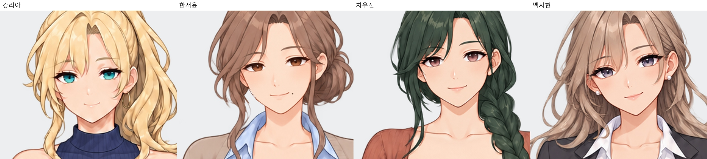
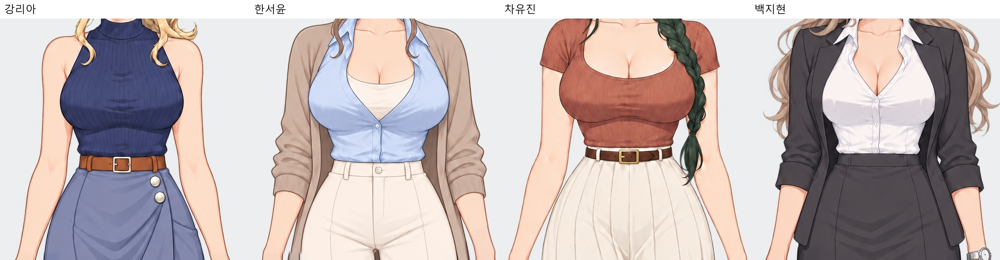
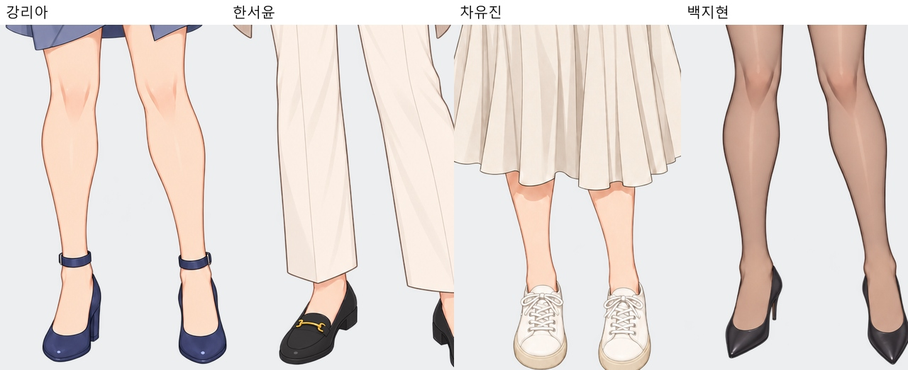

# 전체 히로인 그림체 검수 v26

2026-10-11 · 얼굴 크기 조정 v25 이후 현재 원화 **46장**과 중복 표정을 제외한 **22개 자세**를 검수했습니다. 검수 기준 커밋: `a63b96f01aed71e4fad27c827ef419be5df059e1`.

**같은 미연시 애니메이션 그림체 계열로는 잘 묶이지만, 확대하면 채색·광택·명암 처리 차이가 남습니다. 정밀한 작화 통일을 완료했다고 보기는 어렵습니다.**

|인물|그림체 검수 결과|리아 기준으로 맞출 부분|
|---|---|---|
|강리아|기준. 셀 명암 경계와 눈·코·입의 표현이 비교적 안정적이며 포즈별 큰 작화 이탈은 보이지 않음.|현재 얼굴·체형·포즈 유지.|
|한서윤|피부 명암과 코·입의 표현이 더 평평하고 옅어 부드러운 인상. 캐릭터 내부의 포즈·표정 작화는 안정적.|피부 그림자 단계·얼굴 명암 대비를 소폭 맞추기.|
|차유진|전체 계열은 맞지만 코의 점광택·입술·홍채의 빛이 리아보다 조금 강함. 땋은 머리의 넓은 면과 니트의 잔주름은 묘사 밀도가 다름.|코·입술 하이라이트와 피부 명암 강도를 소폭 맞추기.|
|백지현|눈·코·입술·헤어에 광택과 부드러운 그라데이션이 더 강해 가장 매끈하고 세밀하게 보임. 확대 시 얼굴과 팔의 광택 차이도 조금 보임.|얼굴·헤어 광택과 눈의 반사광 처리부터 맞추기.|

조정 우선순위는 **지현 → 서윤 → 유진**으로 판단했습니다. 얼굴 디자인을 다시 바꾸는 작업보다, 현재 외형을 유지한 상태로 하이라이트 크기·피부 그림자 단계·채색의 부드러움을 맞추는 작업이 적절합니다.

머리색·눈색·헤어 모양·옷 색·신발 디자인은 의도된 인물별 차이입니다. 니트·셔츠·재킷·가죽 신발·스타킹도 소재가 달라 같은 광택으로 칠하면 오히려 어색해질 수 있습니다. 지현의 스타킹 명암 자체는 작화 불일치로 판정하지 않았습니다. 소재 차이와 별개로 얼굴 피부·코·입의 렌더링을 비교했습니다.

인물별 포즈·표정 안에서 갑자기 실사풍이 되거나, 얼굴과 전신이 완전히 다른 그림체로 분리되는 큰 이탈은 확인되지 않았습니다. 특히 유진·지현은 새 얼굴 크기 기준을 같은 캐릭터의 여러 자세에서도 유지합니다. 현재 남은 차이는 주로 세부 광택과 그림자 표현입니다. 이것은 검수자의 시각적 판단이며 객관적인 동일도 퍼센트로 제시하지 않았습니다.

## 자세별 같은 배율 비교

[MASTER](master_4인.jpg) · [듣는 자세](listening_4인.jpg) · [업무/설명](work_4인.jpg) · [캐주얼](casual_4인.jpg) · [대표](signature_4인.jpg).

|인물|모든 전신|모든 얼굴·표정|
|---|---|---|
|강리아|[보기](강리아_모든전신.jpg)|[확대](강리아_모든얼굴.jpg)|
|한서윤|[보기](한서윤_모든전신.jpg)|[확대](한서윤_모든얼굴.jpg)|
|차유진|[보기](차유진_모든전신.jpg)|[확대](차유진_모든얼굴.jpg)|
|백지현|[보기](백지현_모든전신.jpg)|[확대](백지현_모든얼굴.jpg)|

원화에서 같은 배율로 잘라 동일한 회색 배경 위에 비교했습니다. 색 보정·선명화·그림체 수정은 적용하지 않았습니다. 원화 46장의 SHA-256 해시가 검수 전과 동일함을 확인했습니다. 이번 변경은 검수 자료와 보고서만 추가합니다. [검수 대상](검수대상.json) · [검수 결과](검수결과.json) · [현재 히로인](../../히로인/README.md).
