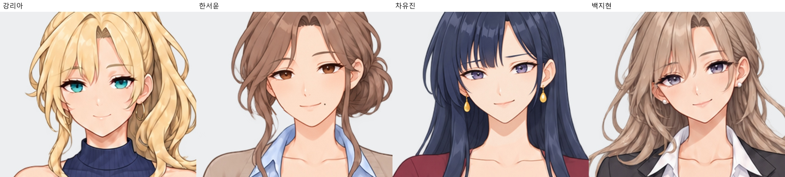
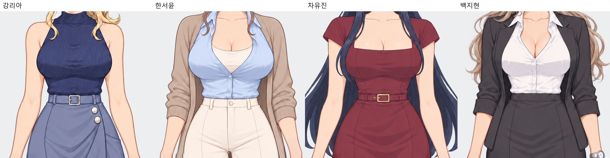
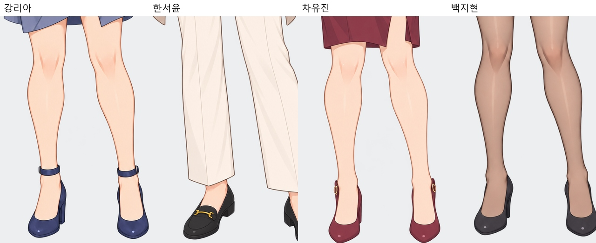
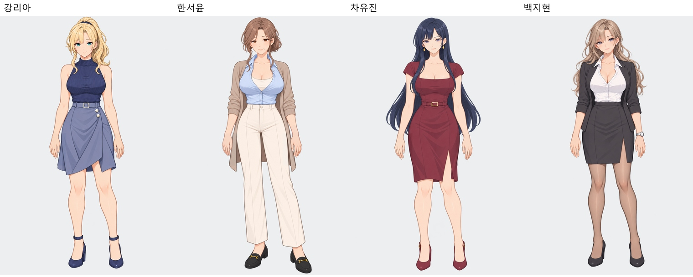
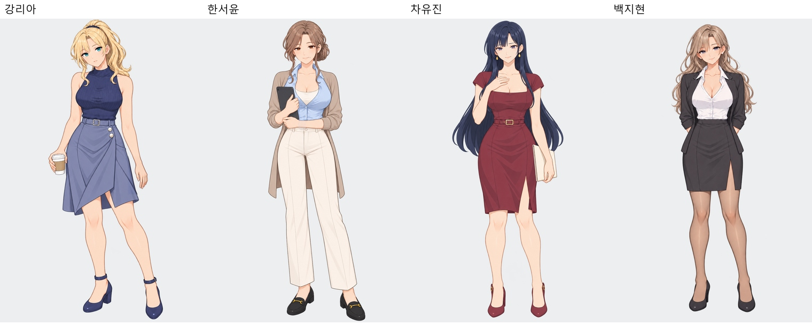
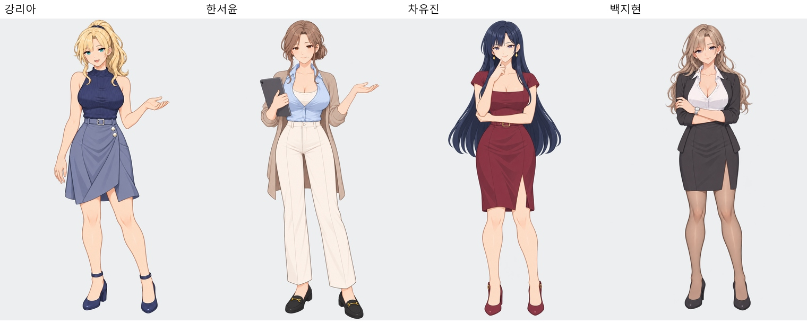
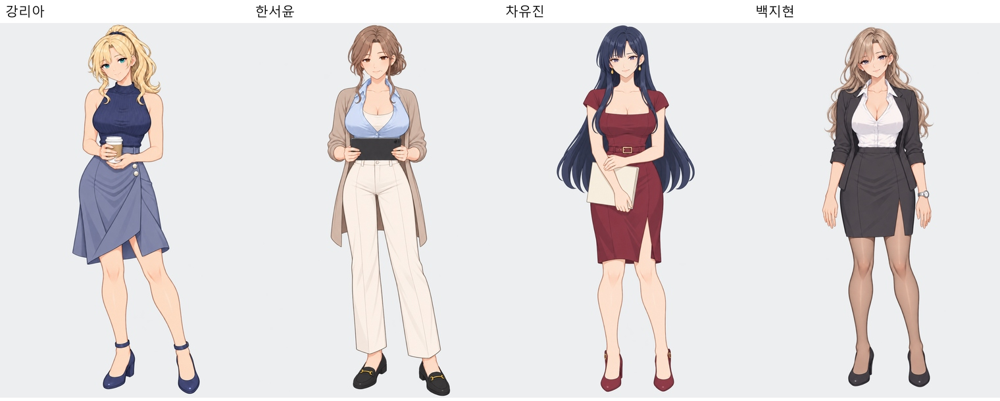
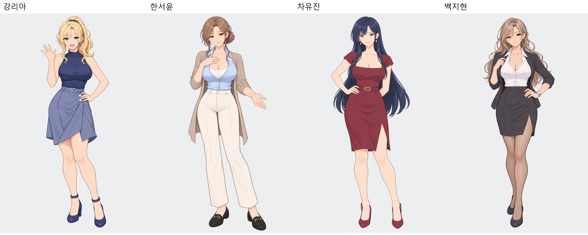

# 현재 히로인 그림체 비교

2026-10-11, 시계 제거를 반영한 현재 원화 46장을 기준으로 검수했습니다. 강리아를 기준으로 MASTER·듣는 자세·업무/설명·캐주얼·대표 포즈를 나란히 비교하고, 모든 기본/진지 표정과 리아 추가 포즈도 확인했습니다. 비교 이미지는 현재 파일의 크롭·배치이며 캐릭터 이미지는 수정하지 않았습니다.

## 판단

네 명은 대체로 같은 미연시 애니 작화 계열입니다. 얇은 윤곽선, 단순화한 코·입, 눈의 채색 방식, 부드러운 셀 명암이 공통입니다. 같은 작품에서 함께 사용할 정도의 일관성은 있습니다. 다만 명암 경계·광택·머리카락의 세부 밀도까지 완전히 동일하게 마감된 상태는 아닙니다.

|항목|관찰|판단|
|---|---|---|
|얼굴·선화|네 명 모두 얇은 선과 비슷한 눈·코·입 렌더링 구조를 사용합니다. 얼굴형·눈매·색상 차이는 캐릭터 개성입니다.|대체로 통일|
|머리카락|리아의 금발·지현의 웨이브는 여러 층의 밝고 어두운 부분이 세밀하게 나뉩니다. 유진의 긴 머리는 큰 색면과 단순한 세로 하이라이트가 중심입니다.|세부 밀도 차이 있음; 직모·웨이브·머리색 차이도 고려해야 함|
|피부|밝은 복숭아색 바탕과 따뜻한 그림자색이 공통입니다. 포즈별 그림자 대비와 경계의 부드러움이 조금 다릅니다.|큰 작화 괴리는 없음; 대비/경계 기준을 더 맞출 수 있음|
|옷·하체|리아의 니트·스커트는 비교적 절제된 광택과 분리된 그림자 면이 보입니다. 지현의 흰 셔츠·스타킹은 넓은 밝은 면과 부드러운 그라데이션 때문에 입체감이 강합니다. 서윤은 밝고 부드러운 대비가 중심입니다.|지현의 명암·광택 차이가 가장 눈에 띔; 재질 자체의 차이를 모두 그림체 불일치로 판단하지는 않음|
|포즈·표정|인물 안에서 MASTER와 다른 포즈·표정의 작화 계열은 유지됩니다. 생성형 제작에 따른 미세한 형태/명암 차이는 보입니다.|전혀 다른 그림체의 포즈가 섞인 수준은 아님|

추가 통일을 한다면 지현의 셔츠·스타킹 명암/광택 강도, 유진 머리의 하이라이트 경계와 세부 밀도, 서윤의 낮은 대비를 순서대로 살펴볼 수 있습니다. 캐릭터별 얼굴형·헤어스타일·체형은 유지하고 강리아 기준의 선색·그림자 경계·광택 표현을 공통 기준으로 잡는 것이 적절합니다. 모든 소재를 같은 질감으로 그리는 것은 목표가 아닙니다.

이는 비교 이미지에 근거한 시각적 판단이며 객관적인 일치율/점수로 환산하지 않았습니다. 이번 작업은 검수와 비교 자료 작성입니다.

## 확대 비교

## 포즈 비교

## 인물별 전체 이미지

|인물|모든 얼굴·표정|모든 전신|
|---|---|---|
|강리아|[얼굴](강리아_모든얼굴.jpg)|[전신](강리아_모든전신.jpg)|
|한서윤|[얼굴](한서윤_모든얼굴.jpg)|[전신](한서윤_모든전신.jpg)|
|차유진|[얼굴](차유진_모든얼굴.jpg)|[전신](차유진_모든전신.jpg)|
|백지현|[얼굴](백지현_모든얼굴.jpg)|[전신](백지현_모든전신.jpg)|

[46개 원화 목록 및 기준 커밋](검수대상.json)
