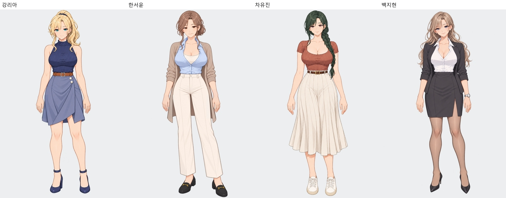
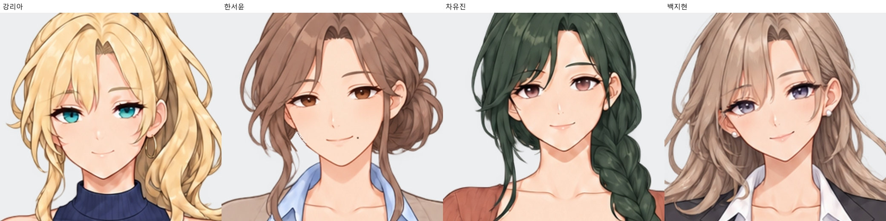
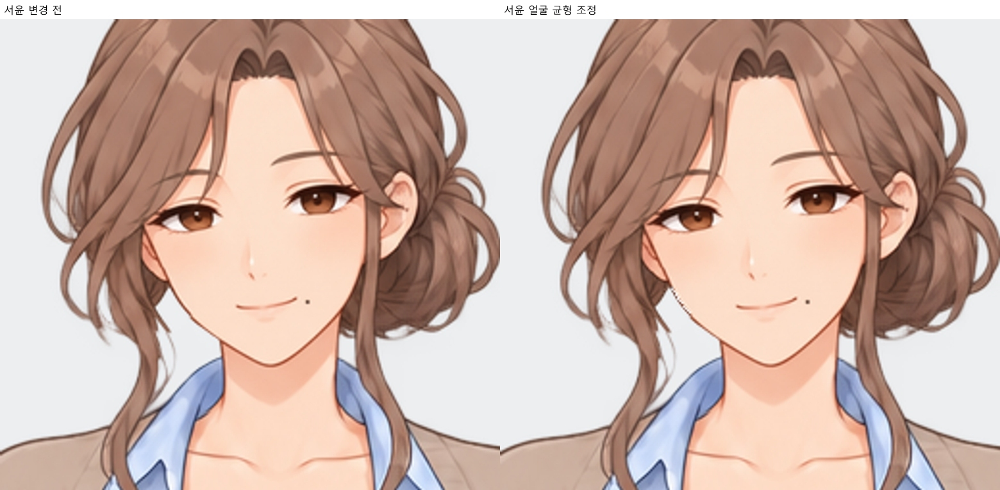
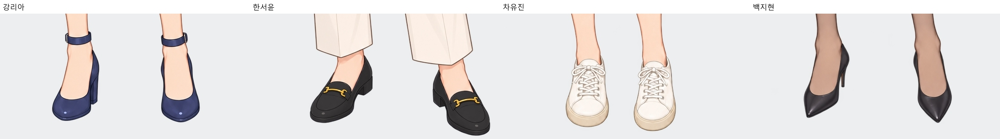

# 얼굴 균형 · 전체 디테일 재검수 v24

2026-10-11. 사용자 요청에 따라 **기존 키·체형·발 위치를 유지**했습니다. 전신 크기나 눈높이를 강제로 맞추는 변환은 적용하지 않았습니다.

서윤은 얼굴 안쪽 비율과 눈·코·입 배치를 소폭 정리하고 11장에 반영했습니다. 기존 턱선·머리 윤곽·귀와 장신구 제거 상태를 보존했습니다. 리아·유진·지현 35장 원화는 유지했습니다. 인물별 얼굴형과 기울어진 자세의 원근 차이는 남겼으며, 서로 같은 얼굴로 바꾸지 않았습니다.

전신·얼굴 46장과 중복 표정을 제외한 22개 자세의 귀·손·손톱·벨트·신발을 확대 비교했습니다. 검토한 확대 자료에서 새로 고쳐야 할 뚜렷한 구조 오류는 찾지 못했습니다. 가려진 손가락과 귀는 보이는 범위에서 판단했고, 자세에 따른 접힘·원근과 개별 얼굴형 차이는 정상적인 차이로 남겼습니다.

|캐릭터|전체 전신|전체 얼굴|손·손톱|귀·장신구|신발|
|---|---|---|---|---|---|
|강리아|[보기](강리아_모든전신.jpg)|[확대](강리아_모든얼굴.jpg)|[확대](강리아_모든손.jpg)|[확대](강리아_귀확대.jpg)|[확대](강리아_신발확대.jpg)|
|한서윤|[보기](한서윤_모든전신.jpg)|[확대](한서윤_모든얼굴.jpg)|[확대](한서윤_모든손.jpg)|[확대](한서윤_귀확대.jpg)|[확대](한서윤_신발확대.jpg)|
|차유진|[보기](차유진_모든전신.jpg)|[확대](차유진_모든얼굴.jpg)|[확대](차유진_모든손.jpg)|[확대](차유진_귀확대.jpg)|[확대](차유진_신발확대.jpg)|
|백지현|[보기](백지현_모든전신.jpg)|[확대](백지현_모든얼굴.jpg)|[확대](백지현_모든손.jpg)|[확대](백지현_귀확대.jpg)|[확대](백지현_신발확대.jpg)|

리아는 갈색 가죽 벨트·발목 스트랩 힐, 서윤은 시계·귀걸이 없는 상태와 금속 장식 로퍼, 유진은 짙은 갈색 가죽 벨트·아이보리 스니커즈·턱 검지·팔꿈치 받침·양손 허리, 지현은 기존 장신구·뾰족코 블랙 펌프스를 확인했습니다.

원화 46장(1024×1536), 2배 확대본 46장(2048×3072), 게임용 46파일의 치수와 해시를 대조했습니다. **전체 46장 원화의 알파 채널과 얼굴 영역 밖 RGB 픽셀이 원본과 동일**하므로 키·체형·팔·손·벨트·신발·발 위치가 보존됩니다. 기본 표정은 해당 자세와 파일 해시가 동일합니다. 표정/자세 선택 48개와 실제 대표 자세 대사 8곳의 연결 검증을 통과했습니다. 실제 RenPy 실행 플레이 테스트는 수행하지 않았습니다. [파일 검증](적용검증.json) · [전체 히로인](../../히로인/README.md).
