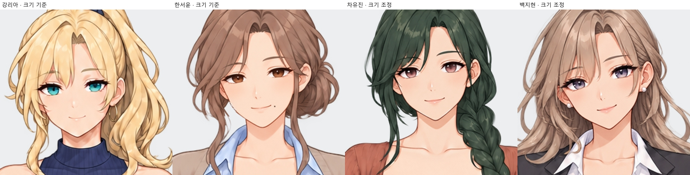
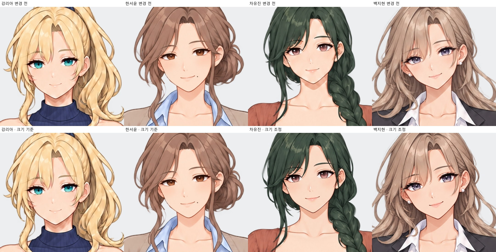
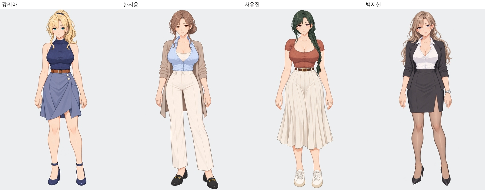

# 유진·지현 얼굴 크기 통일 v25

2026-10-11. 강리아·한서윤의 현재 얼굴을 같은 확대 배율로 비교한 기준으로 사용해, 유진·지현의 **얼굴 윤곽과 크기**를 맞췄습니다. 유진의 짧아 보이던 볼·턱 길이를 늘리고, 지현의 볼·턱 윤곽과 얼굴 존재감을 함께 조정했습니다. 각자의 얼굴형·눈 색·헤어스타일·인상과 자세는 유지합니다.

**기존 키·체형·몸·복장·벨트·신발·발 위치를 유지했습니다.** 리아·서윤 원화 24장은 기준 이미지 그대로이며, 유진·지현 마스터·포즈·표정 22장과 2배 확대본·게임용 22파일을 갱신했습니다.

각 캐릭터의 새 마스터 얼굴을 포즈별 머리 위치에 맞춰 반영했습니다. 고개 기울기가 다른 대표 자세도 같은 얼굴 크기 기준으로 수정했습니다. 진지한 표정은 새 얼굴 윤곽을 유지한 채 눈·눈썹·입만 바꾸어 턱선이 중복되지 않도록 했습니다. 유진의 턱 검지를 가리는 합성은 수정해 기존 손가락과 손톱을 보존했습니다.

|인물|전후 비교|모든 전신|모든 얼굴·표정|귀·장신구|손|
|---|---|---|---|---|---|
|차유진|[비교](차유진_얼굴전후.jpg)|[보기](차유진_모든전신.jpg)|[확대](차유진_모든얼굴.jpg)|[확대](차유진_귀확대.jpg)|[확대](차유진_손확대.jpg)|
|백지현|[비교](백지현_얼굴전후.jpg)|[보기](백지현_모든전신.jpg)|[확대](백지현_모든얼굴.jpg)|[확대](백지현_귀확대.jpg)|[확대](백지현_손확대.jpg)|

[유진 턱 검지 확대](유진_턱검지_확대.jpg). 유진은 귀걸이 없는 귀, 지현은 기존 두 개의 작은 귀걸이를 유지했습니다. 확대 검토에서 추가로 뚜렷한 턱선 중복·귀 돌기·손 구조 오류는 찾지 못했습니다.

원화 46장·2배 확대본 46장·게임용 46파일의 치수·해시를 대조했습니다. 각 원화에서 머리 편집 범위 밖의 RGBA 픽셀은 원본과 동일하고, 투명도를 기준으로 측정한 머리 최상단·발 최하단·전체 높이가 유지됩니다. 기본 표정은 해당 자세와 동일한 파일입니다. 표정/자세 선택 48개와 실제 대표 자세 대사 8곳의 연결 검증도 통과했습니다. 실제 RenPy 실행 플레이 테스트는 수행하지 않았습니다. [파일 검증](적용검증.json) · [영역·키 보존 검증](보존검증.json) · [전체 히로인](../../히로인/README.md).
