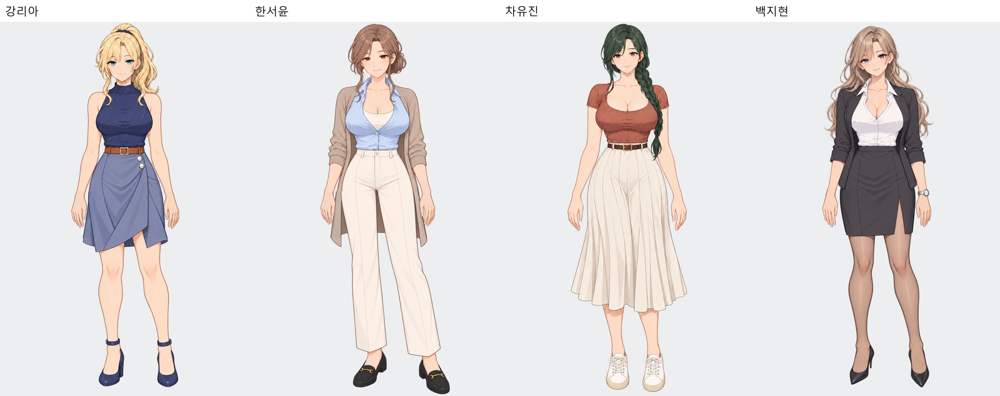
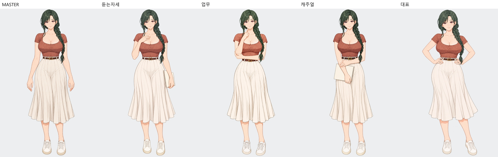
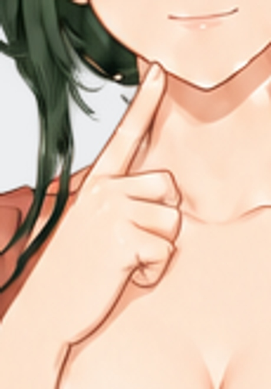
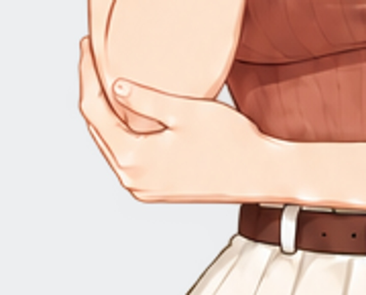
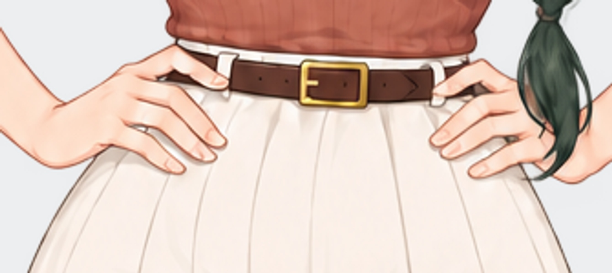
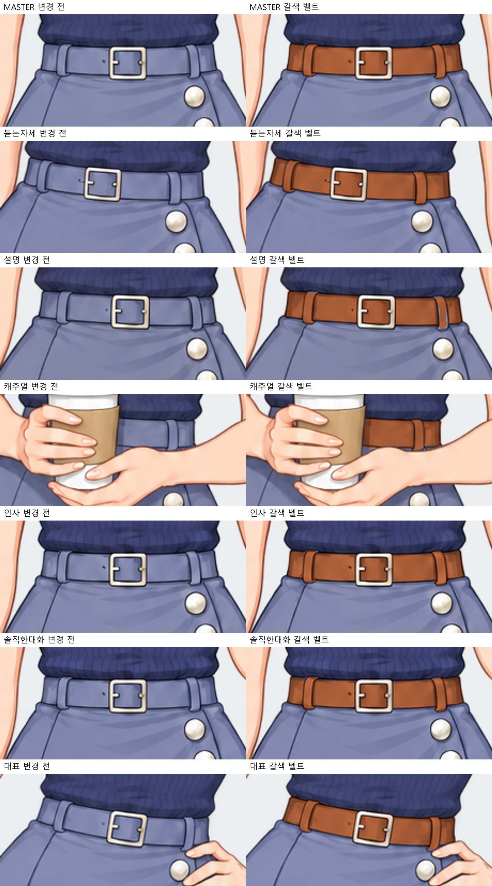
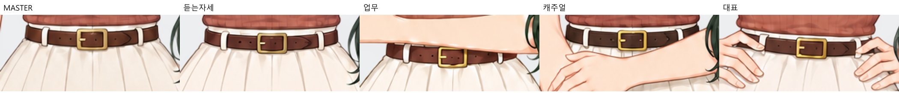
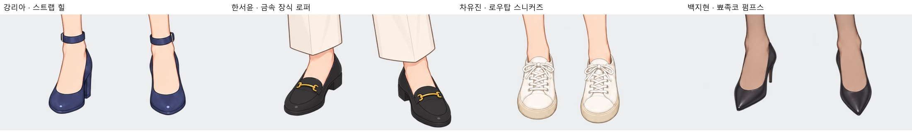

# 유진 외형 확정 · 벨트와 신발 정리 v23

차유진을 선택한 두 번째 이미지의 짙은 녹색 옆땋음 외형으로 교체했습니다. 스니커즈·짙은 갈색 가죽 벨트를 모든 자세에 맞췄고, 팔꿈치를 받치는 손과 턱 검지의 길이를 수정했습니다. 대표 자세는 양손을 허리에 올립니다. 강리아는 같은 MASTER 벨트 색조와 기존 형태를 모든 자세에 통일했습니다. 백지현 신발은 뾰족코 블랙 펌프스로 다듬었습니다.

## 손 디테일

## 벨트 통일

## 인물별 신발

리아: 네이비 스트랩 힐 · 서윤: 금속 장식 로퍼 · 유진: 아이보리 로우탑 스니커즈 · 지현: 뾰족코 블랙 펌프스.

[유진 원본·업스케일](../../히로인/차유진/README.md) · [리아 원본·업스케일](../../히로인/강리아/README.md) · [지현 원본·업스케일](../../히로인/백지현/README.md)

[유진 모든 전신](차유진_모든전신.jpg) · [유진 모든 얼굴](차유진_모든얼굴.jpg) · [리아 모든 전신](강리아_모든전신.jpg) · [지현 모든 전신](백지현_모든전신.jpg)

내장 image_gen 사용. [실제 제작 프롬프트](제작프롬프트.json). 확대본은 Lanczos3 2배 리샘플링입니다. 원화·업스케일·게임용 파일을 함께 갱신했습니다.

원화 46장·2배 확대본 46장·게임용 46파일의 치수·투명도·해시를 대조했고, 48개 표정/자세 선택과 대표 자세 대사 8곳의 연결 검증을 통과했습니다. 실제 RenPy 플레이 테스트는 수행하지 않았습니다. [적용 검증](적용검증.json).
