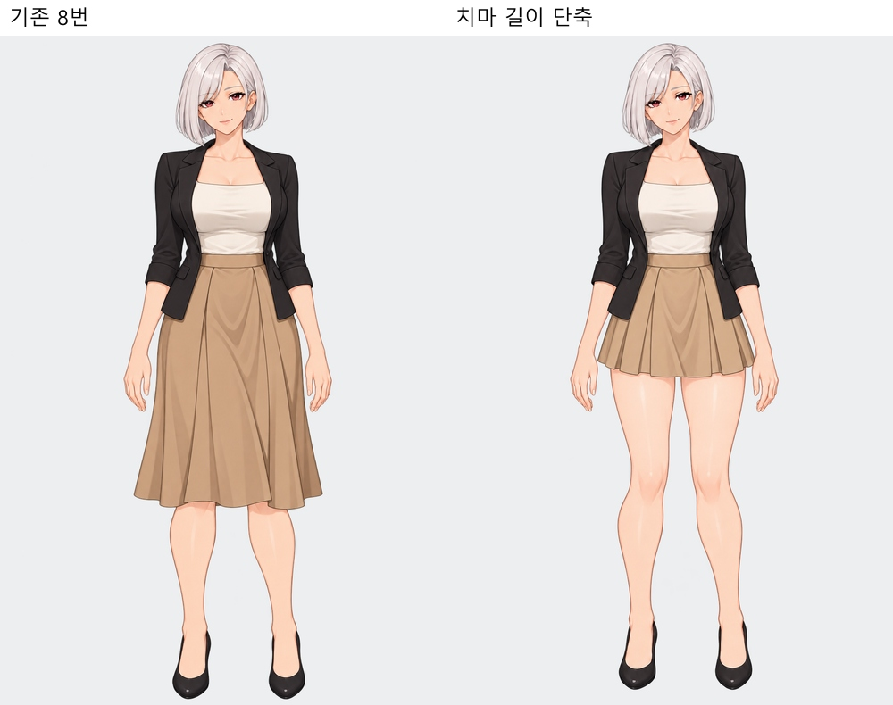
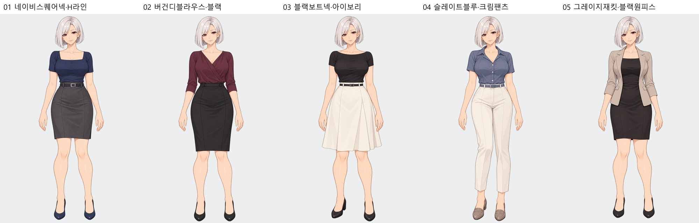

# 차유진 · 8번 치마 단축 + 추천 복장 5종

## 8번 치마 단축

21번 모음 8번의 카멜색 플리츠 스커트를 허벅지 중간 길이로 줄인 버전입니다.

[투명 PNG](00_08번치마단축.png) · [전신 확대](00_08번치마단축_전신.jpg) · [얼굴·양손 검수](00_08번치마단축_확대검수.jpg)

## 이 얼굴에 어울리는 추천 복장 5종

|번호|복장|추천 사유|전신|투명 PNG|확대 검수|
|---|---|---|---|---|---|
|01|네이비 스퀘어넥 반소매 탑·차콜 H라인 스커트|짙은 네이비가 백금색 머리와 대비되고 스퀘어넥이 얼굴의 깔끔한 인상과 어울림|[전신](01_네이비스퀘어넥·H라인_전신.jpg)|[PNG](01_네이비스퀘어넥·H라인.png)|[얼굴·양손](01_네이비스퀘어넥·H라인_확대검수.jpg)|
|02|버건디 드레이프 블라우스·블랙 펜슬 스커트|버건디가 붉은 눈과 연결되고 부드러운 드레이프가 성숙한 얼굴을 돋보이게 함|[전신](02_버건디블라우스·블랙_전신.jpg)|[PNG](02_버건디블라우스·블랙.png)|[얼굴·양손](02_버건디블라우스·블랙_확대검수.jpg)|
|03|블랙 보트넥 반소매 니트·아이보리 A라인 스커트|백금 머리와 흑백 배색이 선명하고 단정한 목선이 얼굴과 잘 맞음|[전신](03_블랙보트넥·아이보리_전신.jpg)|[PNG](03_블랙보트넥·아이보리.png)|[얼굴·양손](03_블랙보트넥·아이보리_확대검수.jpg)|
|04|슬레이트블루 오픈칼라 블라우스·크림 슬랙스|차분한 푸른색이 머리색과 조화되고 크림색 팬츠가 인상을 부드럽게 만듦|[전신](04_슬레이트블루·크림팬츠_전신.jpg)|[PNG](04_슬레이트블루·크림팬츠.png)|[얼굴·양손](04_슬레이트블루·크림팬츠_확대검수.jpg)|
|05|그레이지 재킷·블랙 스퀘어넥 원피스|부드러운 재킷색과 블랙 원피스가 성숙한 얼굴을 강조하면서 전체 인상을 정돈함|[전신](05_그레이지재킷·블랙원피스_전신.jpg)|[PNG](05_그레이지재킷·블랙원피스.png)|[얼굴·양손](05_그레이지재킷·블랙원피스_확대검수.jpg)|

내장 image_gen 사용. [실제 제작 프롬프트](제작프롬프트.json) · [검수 기록](검수기록.json).
