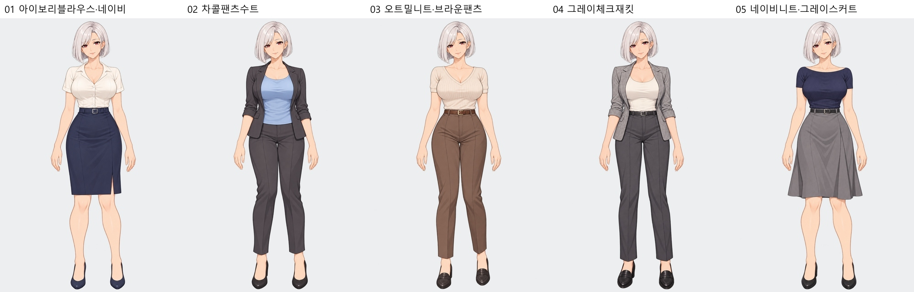
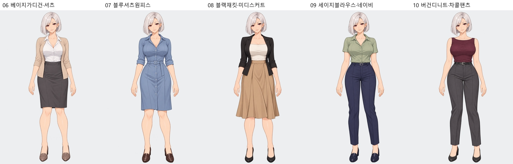
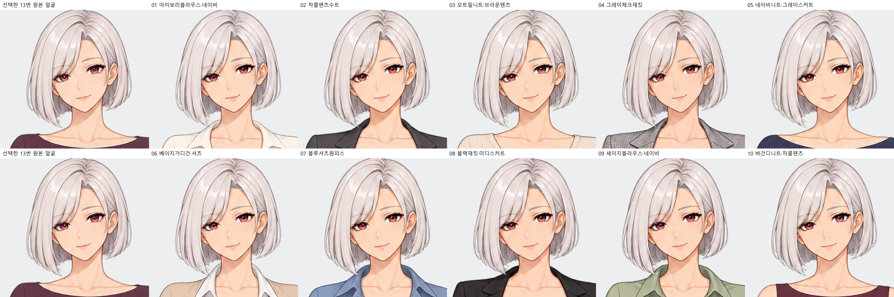

# 차유진 백금 보브 · 현실적인 오피스 복장 10종

단정하면서 쇄골·팔·무릎선의 노출이 있는 비즈니스 캐주얼 출근복 후보입니다. 백금 보브 얼굴·헤어·체형·작화 계열을 기준으로 제작했습니다.

|번호|복장|전신|투명 PNG|확대 검수|
|---|---|---|---|---|
|01|아이보리 V넥 반소매 블라우스·네이비 무릎길이 H라인 스커트|[전신](01_아이보리블라우스·네이비_전신.jpg)|[PNG](01_아이보리블라우스·네이비.png)|[얼굴·양손](01_아이보리블라우스·네이비_확대검수.jpg)|
|02|차콜 팬츠수트·연한 블루 스쿱넥 이너|[전신](02_차콜팬츠수트_전신.jpg)|[PNG](02_차콜팬츠수트.png)|[얼굴·양손](02_차콜팬츠수트_확대검수.jpg)|
|03|오트밀 반소매 V넥 니트·브라운 슬랙스|[전신](03_오트밀니트·브라운팬츠_전신.jpg)|[PNG](03_오트밀니트·브라운팬츠.png)|[얼굴·양손](03_오트밀니트·브라운팬츠_확대검수.jpg)|
|04|그레이 잔체크 재킷·아이보리 스쿱넥 이너·차콜 팬츠|[전신](04_그레이체크재킷_전신.jpg)|[PNG](04_그레이체크재킷.png)|[얼굴·양손](04_그레이체크재킷_확대검수.jpg)|
|05|네이비 반소매 보트넥 니트·그레이 A라인 스커트|[전신](05_네이비니트·그레이스커트_전신.jpg)|[PNG](05_네이비니트·그레이스커트.png)|[얼굴·양손](05_네이비니트·그레이스커트_확대검수.jpg)|
|06|베이지 가디건·화이트 오픈칼라 셔츠·차콜 스커트|[전신](06_베이지가디건·셔츠_전신.jpg)|[PNG](06_베이지가디건·셔츠.png)|[얼굴·양손](06_베이지가디건·셔츠_확대검수.jpg)|
|07|더스티블루 오픈칼라 셔츠 원피스|[전신](07_블루셔츠원피스_전신.jpg)|[PNG](07_블루셔츠원피스.png)|[얼굴·양손](07_블루셔츠원피스_확대검수.jpg)|
|08|블랙 재킷·아이보리 스퀘어넥 이너·카멜 미디스커트|[전신](08_블랙재킷·미디스커트_전신.jpg)|[PNG](08_블랙재킷·미디스커트.png)|[얼굴·양손](08_블랙재킷·미디스커트_확대검수.jpg)|
|09|세이지 반소매 오픈칼라 블라우스·네이비 슬랙스|[전신](09_세이지블라우스·네이비_전신.jpg)|[PNG](09_세이지블라우스·네이비.png)|[얼굴·양손](09_세이지블라우스·네이비_확대검수.jpg)|
|10|버건디 민소매 보트넥 니트·차콜 슬랙스|[전신](10_버건디니트·차콜팬츠_전신.jpg)|[PNG](10_버건디니트·차콜팬츠.png)|[얼굴·양손](10_버건디니트·차콜팬츠_확대검수.jpg)|

## 원본과 얼굴 비교

각 줄 왼쪽은 선택한 13번 원본입니다.

내장 image_gen 사용. [실제 제작 프롬프트](제작프롬프트.json) · [검수 기록](검수기록.json).
