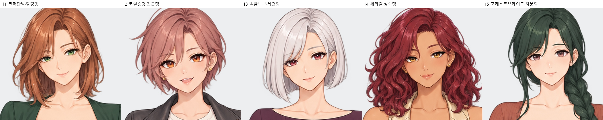
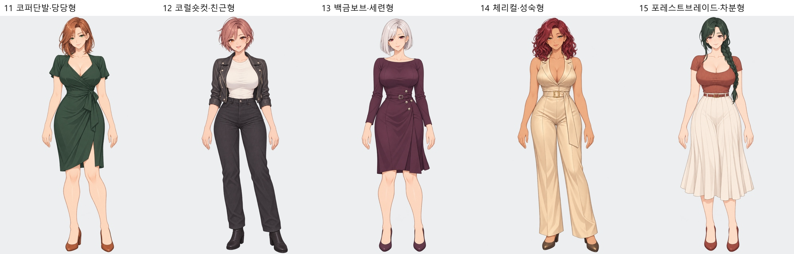
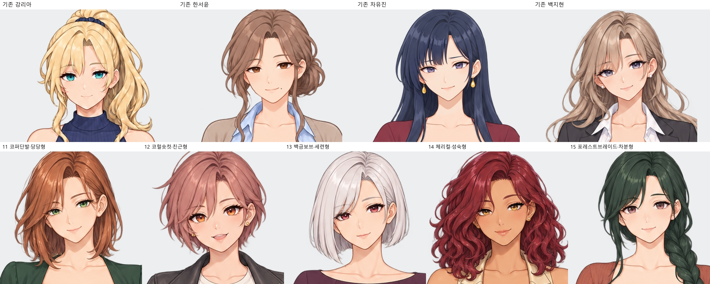

# 차유진 외형 후보 11–15 · 기존 캐릭터와 구분

기존 캐스트와 머리색·헤어 실루엣·눈매·얼굴형·의상을 다르게 설계한 선택용 후보입니다. 성인 체형과 기존 게임 작화 계열을 기준으로 제작했습니다.

## 기존 히로인과 비교

위쪽은 현재 마스터 4명, 아래쪽은 신규 후보 11–15번입니다.

|번호|방향|구분 요소|전신|투명 PNG|확대 검수|
|---|---|---|---|---|---|
|11|[코퍼단발·당당형](11_코퍼단발·당당형_얼굴.jpg)|짧은 코퍼색 로브·초록 눈·딥그린 랩드레스|[전신](11_코퍼단발·당당형_전신.jpg)|[PNG](11_코퍼단발·당당형.png)|[얼굴·양손](11_코퍼단발·당당형_확대검수.jpg)|
|12|[코럴숏컷·친근형](12_코럴숏컷·친근형_얼굴.jpg)|코럴 숏컷·밝은 눈과 미소·라이더 캐주얼|[전신](12_코럴숏컷·친근형_전신.jpg)|[PNG](12_코럴숏컷·친근형.png)|[얼굴·양손](12_코럴숏컷·친근형_확대검수.jpg)|
|13|[백금보브·세련형](13_백금보브·세련형_얼굴.jpg)|백금색 직선 보브·와인색 눈·플럼 드레스|[전신](13_백금보브·세련형_전신.jpg)|[PNG](13_백금보브·세련형.png)|[얼굴·양손](13_백금보브·세련형_확대검수.jpg)|
|14|[체리컬·성숙형](14_체리컬·성숙형_얼굴.jpg)|따뜻한 피부톤·체리색 컬·샴페인 점프수트|[전신](14_체리컬·성숙형_전신.jpg)|[PNG](14_체리컬·성숙형.png)|[얼굴·양손](14_체리컬·성숙형_확대검수.jpg)|
|15|[포레스트브레이드·차분형](15_포레스트브레이드·차분형_얼굴.jpg)|녹색 긴 옆땋음·로즈토프 눈·플리츠 스커트|[전신](15_포레스트브레이드·차분형_전신.jpg)|[PNG](15_포레스트브레이드·차분형.png)|[얼굴·양손](15_포레스트브레이드·차분형_확대검수.jpg)|

내장 image_gen 사용. [실제 제작 프롬프트](제작프롬프트.json) · [기존 캐스트 대조 기록](기존캐릭터_대조검수.json). 확대본은 원본의 크롭·리샘플링입니다.
