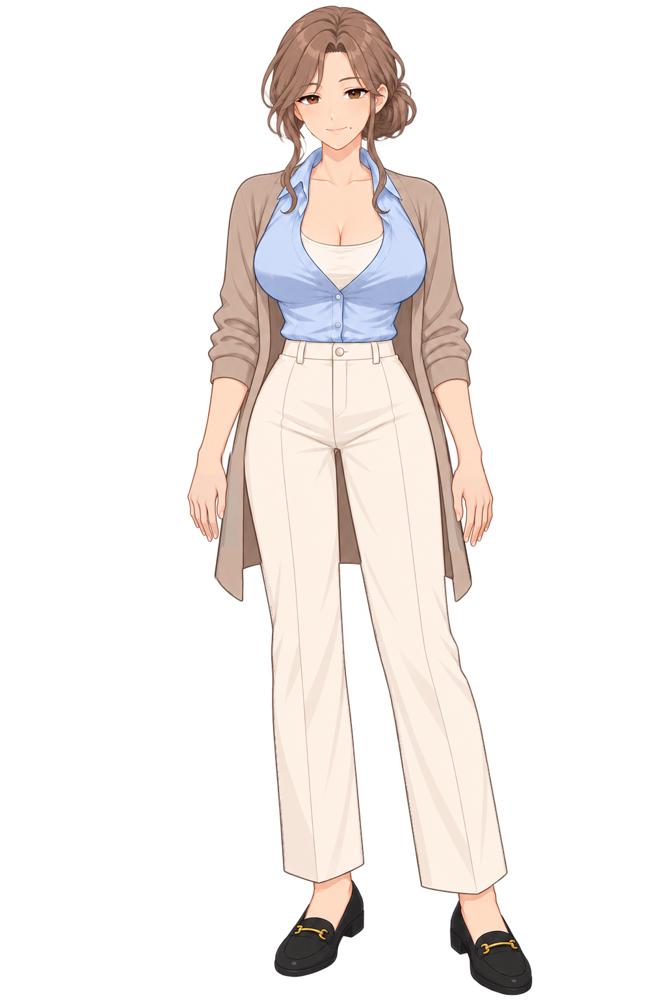
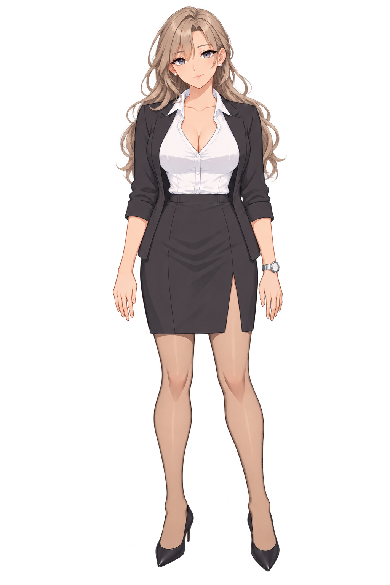

# 히로인 이미지

2026-10-11 · 강리아 기준으로 서윤·유진·지현의 전신 작화를 통일했습니다. 기존 키·체형·얼굴 크기·외형·복장은 유지했습니다. [현재 4인 작화·확대 검수](../미리보기/리아기준_전체작화통일_v27/README.md).

|[강리아](강리아/README.md)|[한서윤](한서윤/README.md)|[차유진](차유진/README.md)|[백지현](백지현/README.md)|
|:---:|:---:|:---:|:---:|
|||||

|인물|원화|2배 확대본|현재 검수 이미지|합계|
|---|---:|---:|---:|---:|
|강리아|13|13|5|31|
|한서윤|11|11|5|27|
|차유진|11|11|5|27|
|백지현|11|11|5|27|

총 112개: 원화 46장·확대본 46장·검수 이미지 20장. 원화는 1024×1536 투명 PNG, 확대본은 2048×3072이며 게임은 확대본 46파일을 사용합니다. 기본 표정 파일은 해당 자세와 동일한 이미지이며 게임의 표정 선택 경로에 사용합니다. 리아의 인사·솔직한 대화와 인물별 대표 자세도 대사에 연결되어 있습니다.

각 인물 폴더는 MASTER.png → 포즈/ → 표정/ → 업스케일/ → 검수자료/ 순서입니다. 이전 후보·미리보기 사진은 정리했고 현재 비교·검수 자료만 남겼습니다. [전체 이미지 목록](이미지목록.md) · [해상도·해시](파일목록.json).
