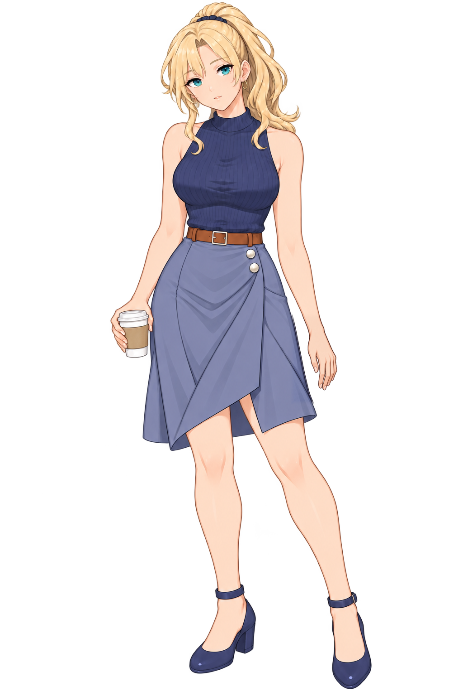
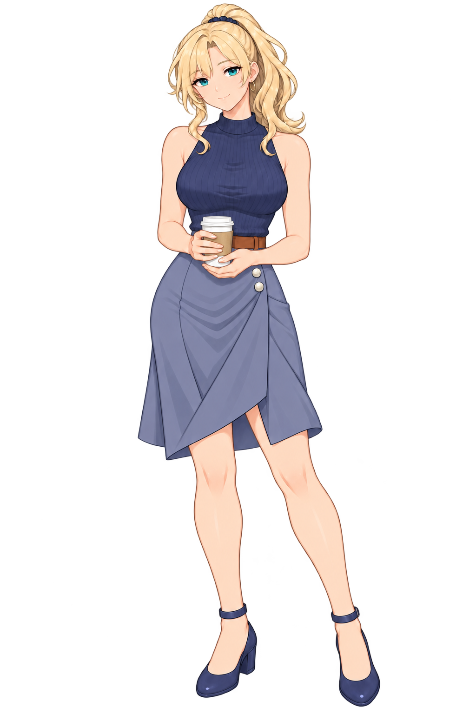
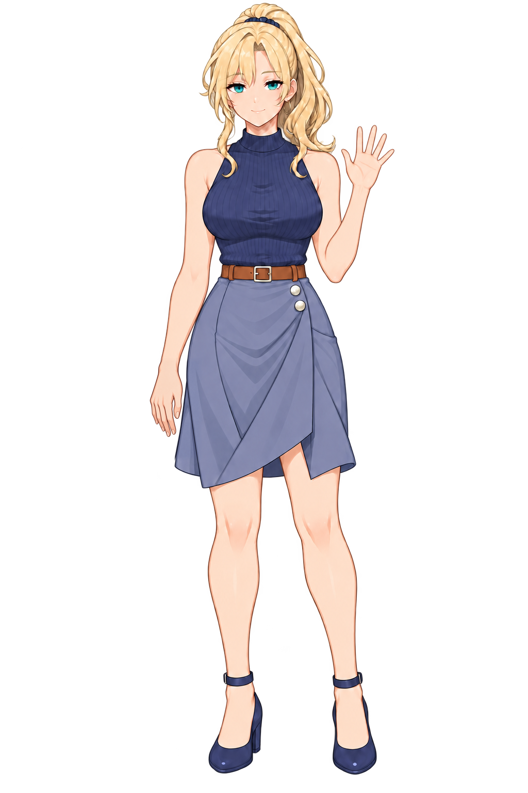
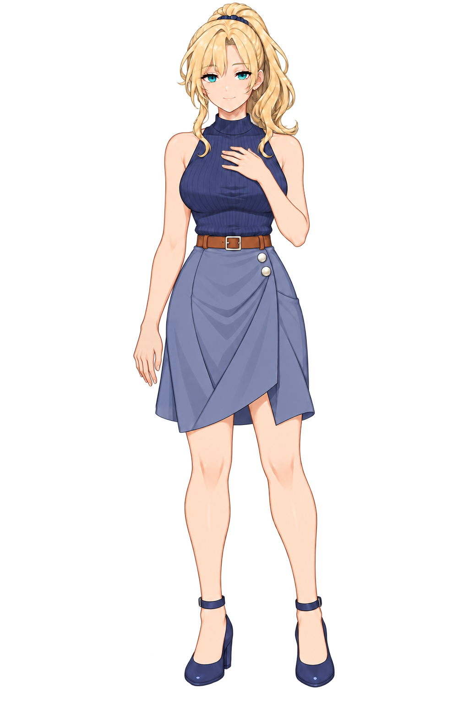
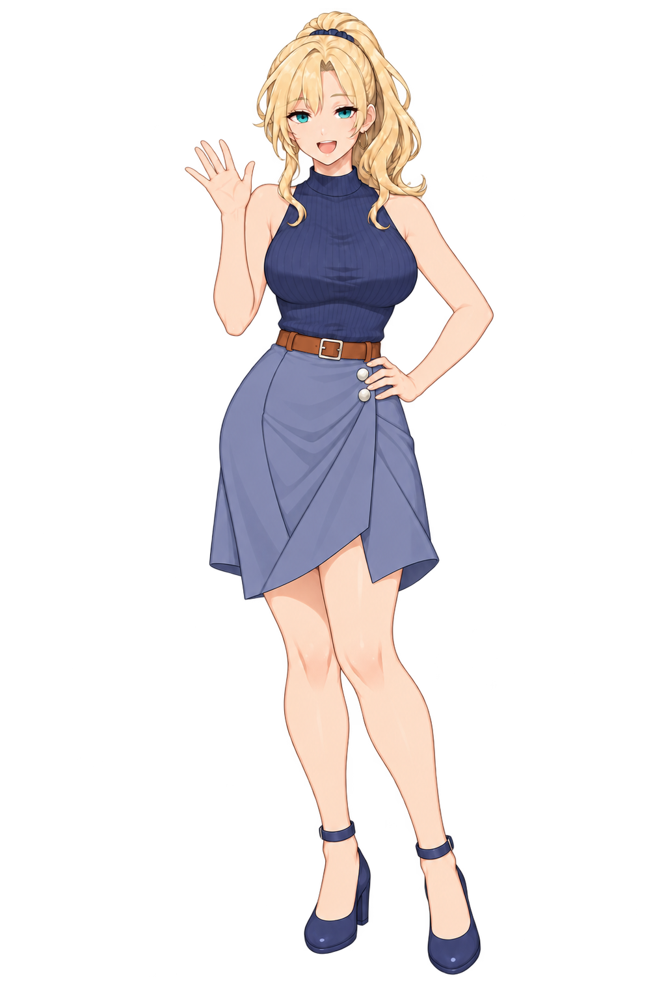
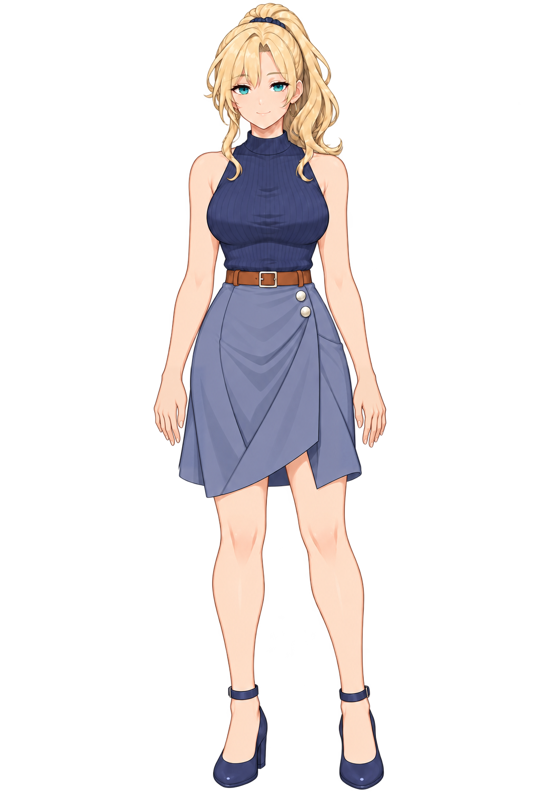
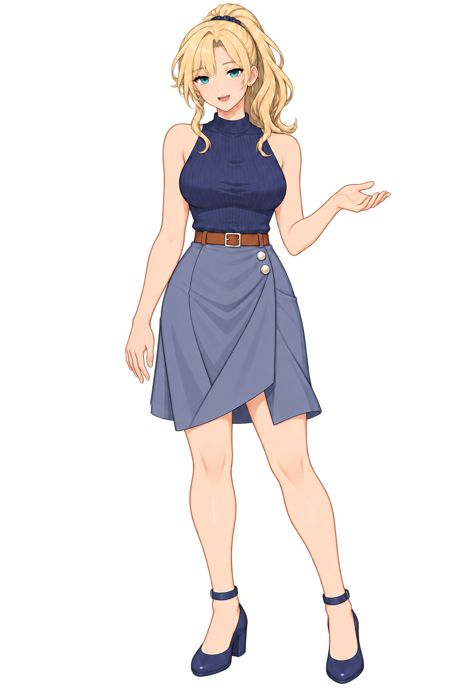

# 강리아

2026-10-11 재검수: 키·체형·발 위치 유지. 승인된 얼굴과 원화를 유지했습니다. [전신·얼굴·귀·손·신발 확대 검수](../../미리보기/얼굴균형_전체재검수_v24/README.md).

[전체 히로인](../README.md) · 원화 13장 · 2배 확대본 13장 · 검수 이미지 5장.

현재 외형은 유지하고 벨트를 따뜻한 갈색 가죽 톤으로 변경했습니다. 모든 포즈·표정에서 같은 MASTER의 색조와 기존 벨트 폭·버클·고리 형태를 기준으로 통일했습니다. 벨트 마스크 밖의 얼굴·헤어·손·복장·신발 픽셀은 보존했습니다.

## 정면 MASTER

[원화](MASTER.png) · [2048×3072 확대본](업스케일/MASTER.png)

## 포즈

|듣는자세|설명|캐주얼|인사|솔직한대화|대표|
|:---:|:---:|:---:|:---:|:---:|:---:|
|||||||

## 표정

|자세|기본|진지|
|---|:---:|:---:|
|MASTER|||
|설명|||
|캐주얼|||

## 검수

[모든 전신](검수자료/전신10장.jpg) · [모든 얼굴](검수자료/얼굴10장.jpg) · [귀 확대](검수자료/귀걸이확대.png) · [MASTER 양손](검수자료/손확대.png) · [대표 자세](검수자료/대표포즈확대.jpg)

[최신 제작 프롬프트](검수자료/v23_제작프롬프트.json) · [영역 보존 검증](검수자료/v23_보존검증.json) · [파일 정보](검수자료/파일정보.json)

원화는 1024×1536 투명 PNG, 확대본과 게임용 파일은 2048×3072입니다. 확대는 Lanczos3 리샘플링으로 새 디테일을 생성하지 않습니다. 기본 표정은 같은 마스터/자세 파일과 동일합니다. 기존 파일명 `전신10장`, `얼굴10장`, `귀걸이확대`는 검수자료 링크 호환을 위해 유지했으며 현재 모든 이미지를 반영했습니다. 이전 제작 기록 JSON은 역사 자료이고 현재 기준은 v23 기록입니다.
