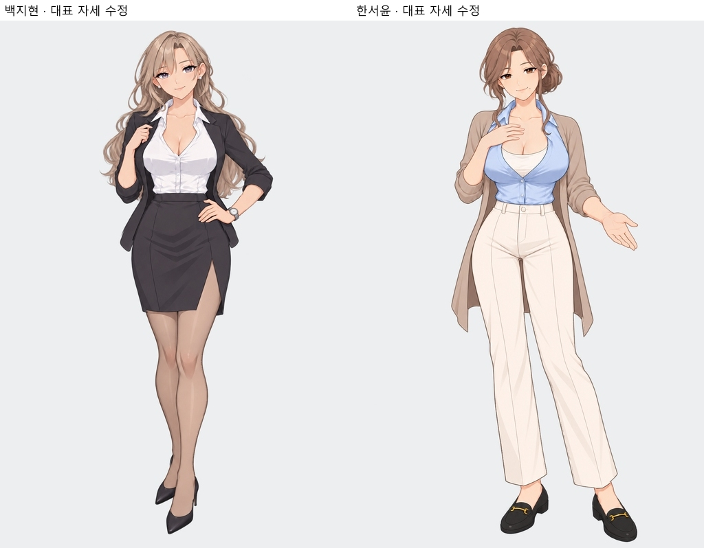
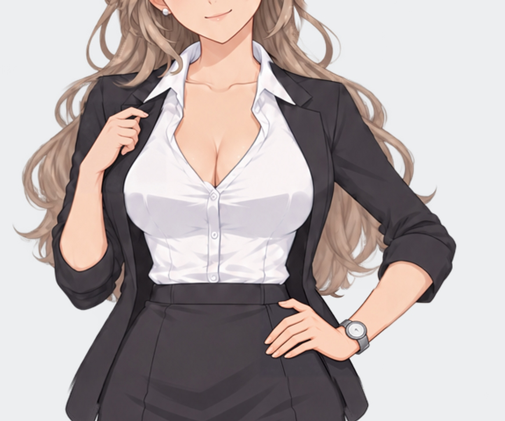
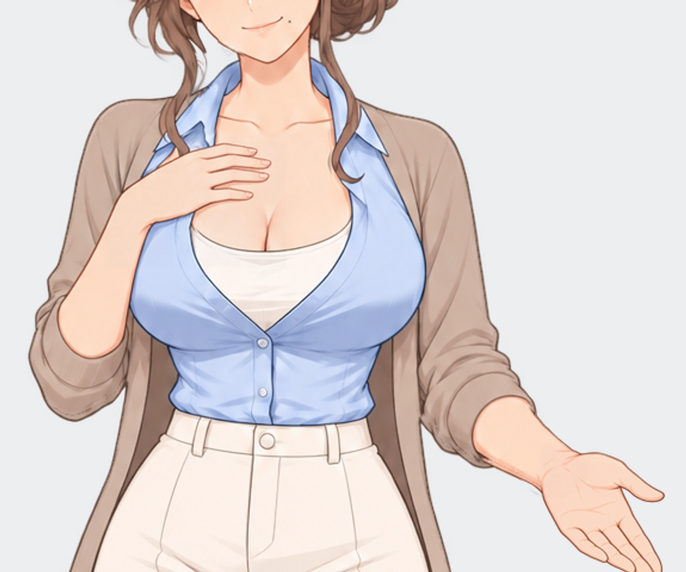

# 대표 사진 디테일 수정 · 현재 검수

2026-10-11 · v29. 지현 대표 사진의 헤어와 양손, 서윤 대표 사진의 가슴 앞 손을 수정했습니다. 리아의 진지한 표정 3장에 남아 있던 투명 윤곽 차이도 같은 자세 기준으로 맞췄습니다. 원화 5파일과 2배 확대본 5파일을 교체했으며 게임은 같은 경로의 새 확대본을 사용합니다.

[히로인 목록](../README.md) · [전체 파일 목록](../이미지목록.md) · [검증 결과](전체검수_v29.json) · [수정 프롬프트와 생성 기록](수정_제작프롬프트_v29.json) · [4인 모든 자세·표정](현재검수/README.md)

## 백지현

어깨·팔 뒤의 반복된 고리와 꼬인 끝부분을 큰 웨이브 흐름으로 정리했습니다. 옷깃 손은 엄지와 검지의 집는 구조, 나머지 접힌 손가락을 더 명확하게 만들었습니다. 허리 손은 급하게 꺾인 모양을 완화하고 엄지와 네 손가락, 손톱을 구분했습니다. 손목·시계 주변 연결도 함께 확인했습니다.

헤어와 팔 주변은 생성된 수정본을 이어 적용하고 연결부를 부드럽게 처리했습니다. 승인된 얼굴·머리 윗부분·귀·귀걸이는 원래 픽셀을 유지했으며, 하체·다리·신발과 발 위치도 원래 픽셀 그대로입니다. 검수했던 발목·구두 연결은 확대해서 재확인했으며 추가 변형은 하지 않았습니다.

## 한서윤

가슴 앞 손의 중지·약지 경계와 손가락 끝 간격을 분명하게 하고 자연스러운 손톱을 추가했습니다. 손의 위치와 부드럽게 가슴 위에 놓는 제스처는 유지했습니다. 엄지는 가려지는 자세를 유지하며 억지로 다섯 손가락을 펼치지 않았습니다. 손 주변 수정 영역 밖의 얼굴·귀·헤어·복장·하체는 기존 픽셀이 유지됩니다.

## 강리아 · 표정 윤곽

MASTER_serious, 설명_serious, 캐주얼_serious의 알파 채널만 같은 기본 자세로 맞췄습니다. 기존 RGB와 진지한 표정은 전부 그대로입니다. 이제 네 인물의 진지한 표정 12장 모두 기본 자세와 원화의 투명 윤곽이 일치합니다.

## 재검수와 적용

원화 46장·확대본 46장의 크기와 투명 채널을 확인했고, 확대본은 Lanczos3 2배 리샘플링 픽셀과 일치합니다. 기본 표정 복제본 12장은 해당 자세와 동일합니다. 수정 대상 5장 외의 원화 41장과 확대본 41장은 해시가 유지됐습니다. 지현·서윤 대표 사진의 얼굴과 하체 보존도 픽셀로 확인했습니다.

전신과 회색 바탕 확대에서 헤어·손가락·손톱·옷깃·손목 연결을 다시 확인했습니다. 그림체는 기존 리아 기준의 얇은 선화와 부드러운 셀 명암을 유지합니다. 시각 검수는 모든 오류 부재를 보증하는 판정은 아닙니다.

표정·포즈 선택 114건과 대표 자세 대사 8건의 경로·로직 검증은 통과했습니다. 실제 Ren’Py 플레이 테스트는 수행하지 않았습니다. 게임용 캐릭터 복사본은 만들지 않았으며 캐릭터 사진은 모두 히로인 폴더에 있습니다.

이전 v28 검수 결과와 v27 제작 JSON은 당시 기록입니다. 현재 파일 판정은 전체검수_v29.json과 각 인물 검수자료/적용검증.json을 사용하세요.
