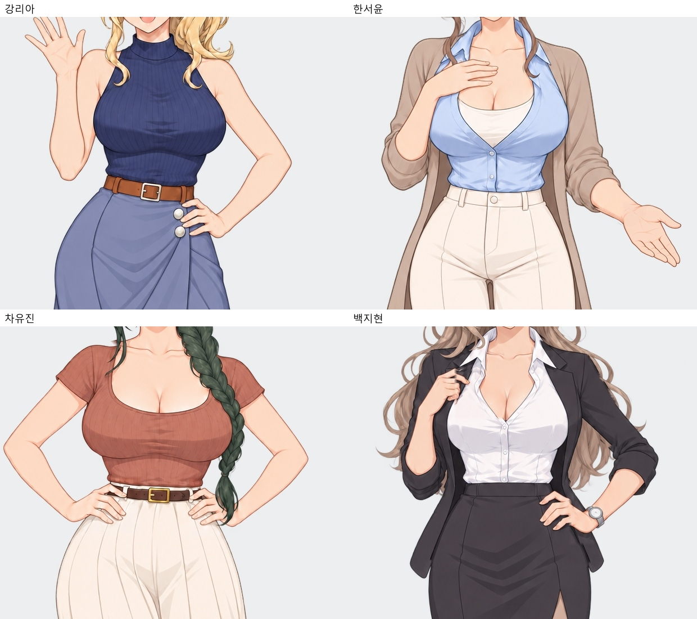
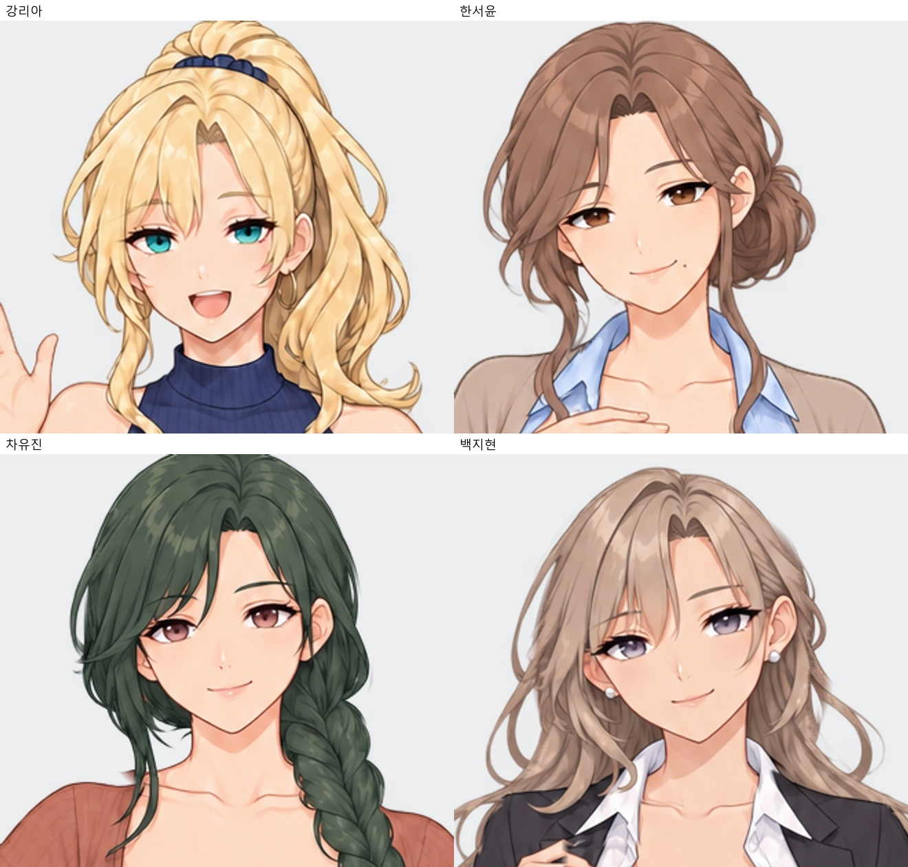
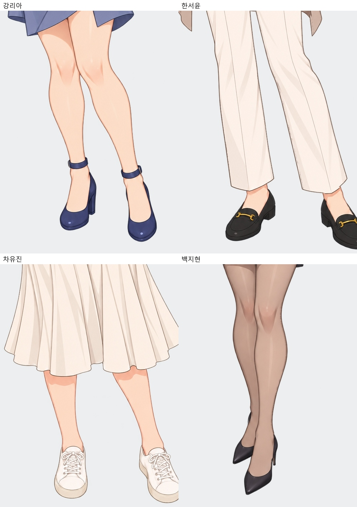

# 전체 히로인 · 대표 자세 확대 검수

2026-10-11 · v28. 마스터·포즈·표정 원화 46장과 확대본 46장을 확인했습니다. 기본 표정 복제본 12장은 해당 자세와 동일합니다. 각 인물의 얼굴·눈 색·헤어·복장·장신구·신발을 마스터와 비교했습니다. **전체를 무결점으로 판정하지 않았습니다. 아래 손 디테일은 보완이 필요합니다.** 이번에는 그림을 새로 생성하거나 수정하지 않았습니다.

[히로인 목록](../README.md) · [전체 파일](../이미지목록.md) · [기술 검증·삭제 목록](전체검수_v28.json) · [전신 작화 비교](현재검수/README.md)

## 대표 사진 판정

|인물|확대 검수 결과|
|---|---|
|강리아|얼굴·귀걸이·갈색 벨트·신발은 마스터와 이어집니다. 인사하는 손의 다섯 손가락은 구분됩니다. 허리 손의 숨은 엄지를 누락으로 단정할 수는 없습니다. 큰 구조 오류는 확인하지 못했습니다.|
|한서윤|마스터의 눈·입가 점·머리·귀걸이와 시계 없는 설정·로퍼가 유지됩니다. 가슴 앞 손은 손가락이 밀착되어 중지·약지 경계가 뭉개지고 손톱 표현도 약합니다. 가려진 엄지를 포함해 손가락 수를 오류로 단정하지는 않았습니다.|
|차유진|양손 허리 자세, 녹색 땋은 머리, 갈색 벨트·금색 버클과 아이보리 스니커즈가 유지됩니다. 손목·팔꿈치 연결에서 뚜렷한 단절은 확인하지 못했습니다. 얼굴이 살짝 기울어진 것은 포즈 차이입니다.|
|백지현|얼굴·진주 귀걸이·시계·복장·신발 종류는 이어집니다. **허리 쪽 손가락이 급하게 꺾여 갈고리처럼 보이는 것이 가장 큰 보완점입니다.** 옷깃을 잡는 반대손도 접힌 손가락과 옷깃의 경계가 불명확합니다. 교차한 다리는 포즈 차이지만 발목과 구두 연결을 재작화 때 함께 다듬는 편이 좋습니다.|

## 모든 자세·표정의 일관성

얇은 애니 선화와 셀 명암이라는 공통 방향은 유지됩니다. 다만 리아의 니트·머리카락은 다른 인물보다 질감과 하이라이트가 조금 더 많아, 완전히 동일한 렌더링이라고 단정하지는 않습니다. 인물별 재질·색 차이와 실제 작화 차이를 구분해 봤습니다.

리아의 고리 귀걸이, 지현의 작은 진주 귀걸이 두 개, 서윤·유진의 귀걸이 없는 설정이 이어집니다. 서윤의 시계도 다시 나타나지 않았습니다. 현재 신발은 리아 스트랩 구두, 서윤 로퍼, 유진 스니커즈, 지현 뾰족 구두로 서로 구분됩니다. 리아·유진의 벨트 색과 버클 계열은 유지되지만 세부 가죽 질감과 명암은 포즈마다 조금씩 다릅니다.

진지한 표정 12장 중 서윤·유진·지현 9장은 해당 기본 자세와 투명 윤곽이 같습니다. **리아의 진지한 표정 3장은 기존 투명 윤곽 차이가 남아 있습니다.** 작은 알파 차이까지 포함하면 각각 148,268 / 143,577 / 125,599픽셀이 다르고, 차이가 16단계를 넘는 픽셀은 6,519 / 7,887 / 6,763개입니다. 이번 정리에서 그림을 바꾸지 않았으며 표정 전환 시 윤곽 변화 여부는 실제 게임에서 추가 확인할 항목입니다.

원화 46장과 확대본 46장은 이번 작업 전후 해시가 유지됐고, 확대본은 원화를 Lanczos3로 2배 리샘플링한 픽셀과 일치합니다. 확대가 원래 손가락의 모호한 구조를 해결해 주는 것은 아닙니다. 확대 검수는 시각적 판단이며 모든 오류 부재를 보증하지 않습니다.

## 폴더 밖 사진 정리

게임 폴더의 캐릭터 중복 PNG 46개를 삭제했습니다. 당시 게임용 파일과 히로인 확대본이 같은 해시임을 확인한 뒤, 게임이 히로인 폴더를 직접 읽게 바꿨습니다. 폴더 밖의 현재 비교 사진 25개는 이 폴더의 현재검수/로 옮겼습니다. 이전 리아 얼굴이 포함된 미사용 테스트 스크린샷 2장도 삭제했습니다. 캐릭터 사진은 모두 히로인 아래에 모였으며 배경·UI와 배경 원본은 유지했습니다. 과거 제작 기록 문서는 남아 있습니다.

전체 저장소를 내려받아 히로인과 RenPy_게임 폴더를 나란히 유지해야 합니다. 경로·대사 로직은 코드 수준에서 확인했으며, SDK가 없는 환경이라 실제 Ren’Py 실행 테스트는 수행하지 않았습니다.
